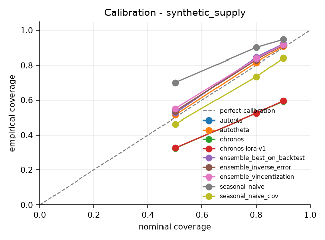
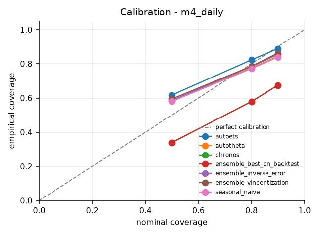
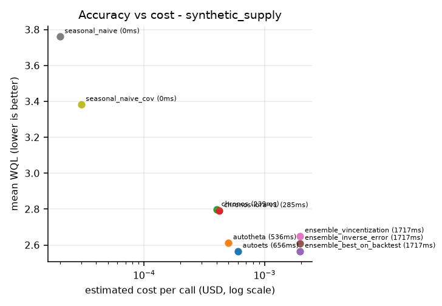
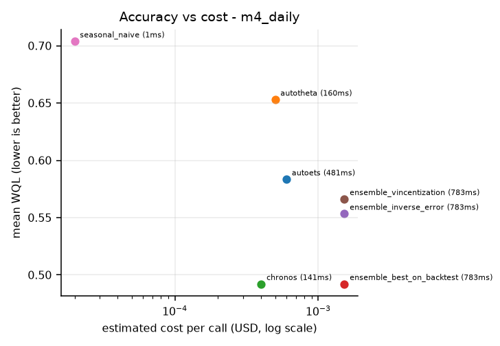

# ForecastMCP

ForecastMCP is an MCP server and agent harness that exposes pretrained time-series foundation models (Chronos T5, with optional TimesFM and Moirai adapters) and classical baselines (seasonal naive, AutoETS, AutoTheta) as typed, budgeted, permissioned, and traced forecasting tools. A client agent inspects a series, requests several candidate forecasters, quantifies their disagreement, reconciles them with a recorded rule, and writes a stakeholder-readable forecast rationale in which every number carries an inline `[call:<id>]` citation back to the trace entry that produced it. A frozen rolling-origin holdout, DuckDB store, OpenTelemetry JSONL tracing, byte-identical replay, a probabilistic evaluation harness with bootstrap CIs, an agent-level evaluation suite, Docker packaging, and a real benchmark (including the negative results) ship in the same repository.

## Architecture

```
                    ┌──────────────────────────────────────────────┐
                    │ Agent loop (forecastmcp/agent)               │
                    │  planner (LLM or deterministic fallback)     │
                    │  -> MCP client session                       │
                    │  -> context compaction (2500-token budget)   │
                    │  -> reconcile -> report.md with citations    │
                    └──────────────────────┬───────────────────────┘
                                           │ MCP (stdio or Streamable HTTP)
                    ┌──────────────────────▼───────────────────────┐
                    │ MCP server (forecastmcp/mcp/server.py)       │
                    │  list_series describe_series forecast        │
                    │  ensemble_forecast backtest model_card sql   │
                    └──────────────────────┬───────────────────────┘
                                           │
                    ┌──────────────────────▼───────────────────────┐
                    │ ToolRuntime                                  │
                    │  Pydantic input/output schemas               │
                    │  permissions (analyst | admin)               │
                    │  BudgetGuard: calls, wall clock, cost,       │
                    │    per-call timeout -> typed BudgetExceeded  │
                    │  OpenTelemetry spans -> trace.jsonl          │
                    │  call outputs -> calls/<call_id>.json        │
                    └───────┬─────────────────────────┬────────────┘
                            │                         │
              ┌─────────────▼────────────┐  ┌─────────▼─────────────┐
              │ Forecaster registry      │  │ DuckDB                │
              │  Chronos T5 (+ LoRA)     │  │  series runs          │
              │  TimesFM / Moirai (opt)  │  │  forecasts metrics    │
              │  SeasonalNaive AutoETS   │  └───────────────────────┘
              │  AutoTheta promo-naive   │
              └──────────────────────────┘
                            │
              artifacts/runs/<run_id>/{trace.jsonl, calls/*.json, report.md}
```

- **Typed tools.** Every tool has a strict Pydantic input and output model; unknown fields and malformed horizons, quantile levels, weights, or covariate lengths are rejected before any model runs.
- **Budgets.** `BudgetGuard` enforces a per-call timeout, per-run call ceiling, wall-clock ceiling, and cost ceiling. Violations raise `BudgetExceeded` with a machine-readable reason; the agent retries with a cheaper model and records the downgrade as an `agent.downgrade` span.
- **Permissions.** `analyst` may inspect, forecast, backtest, ensemble, and run read-only SQL; `admin` additionally may trigger fine-tuning. Denials raise `PermissionDenied` and are logged as spans, never silently ignored.
- **Tracing.** A custom `SpanExporter` appends one JSON line per span to `artifacts/runs/<run_id>/trace.jsonl` with tool name, validated-input SHA-256, model and checkpoint revision, latency, estimated cost, success/error, and the output path/SHA-256. The serialized tool output lives in `calls/<call_id>.json`.
- **Replay.** `forecastmcp replay <run_id>` re-executes every successful call from `trace.jsonl`, normalizes wall-clock-dependent fields, and asserts byte-identical output against the cached call files. Failed calls are re-executed and must fail again.
- **Context compaction.** The agent's `ContextWindow` approximates tokens at four characters per token; when older tool outputs push the context past 2500 tokens it replaces the middle with a summary that preserves call IDs and tool names, and emits an `agent.compaction` span.
- **Freezing.** `configs/holdout.yaml` is written once and committed. Every benchmark, backtest, and agent task reads those exact boundaries; no experiment derives its own splits.

## Installation and usage

Requires Python 3.11. Core install includes PyTorch, the Chronos adapter, the classical
baselines, DuckDB, the MCP SDK, and OpenTelemetry. The `[fm]` extra adds the optional
TimesFM and Moirai adapters.

```bash
python3.11 -m venv .venv
source .venv/bin/activate
pip install -e ".[dev]"        # core: baselines + Chronos adapter, tests, ruff
pip install -e ".[fm,dev]"     # optional TimesFM and Moirai adapters too
```

Chronos weights (`amazon/chronos-t5-tiny`) download on first use and are cached by
Hugging Face. Set `FORECASTMCP_OFFLINE=1` to force the deterministic synthetic
supply-chain panel and restrict the registry to CPU-cheap models, which is how CI
runs without model downloads.

```bash
forecastmcp data prepare --dataset synthetic_supply
forecastmcp data prepare --dataset m4_daily
forecastmcp data describe
forecastmcp models list

forecastmcp forecast --model chronos --dataset synthetic_supply --series S001 --horizon 28
forecastmcp forecast --model seasonal_naive --dataset synthetic_supply --series S001 --horizon 28
```

Run the agent and replay its trace:

```bash
forecastmcp ask "What will capacity demand for S001 look like over the next 4 weeks, with an 80% interval?" --run-id demo
forecastmcp replay demo
```

Run the full benchmark, fine-tune comparison, agent evaluation, plots, and summary:

```bash
scripts/run_all.sh              # full run (~20-35 min on CPU)
scripts/run_all.sh --fast       # CI smoke run on synthetic data
make bench                      # benchmark + plots + summary only
```

Serve the MCP server over stdio (for an MCP client configured as a subprocess):

```bash
forecastmcp serve
```

Or over Streamable HTTP:

```bash
forecastmcp serve --transport streamable-http --host 0.0.0.0 --port 8000
```

An MCP-compatible client configuration for the stdio server:

```json
{
  "mcpServers": {
    "forecastmcp": {
      "command": "/absolute/path/to/ForecastMCP/.venv/bin/forecastmcp",
      "args": ["serve"]
    }
  }
}
```

For the HTTP container, point the client at `http://localhost:8000/mcp`.

Docker:

```bash
docker build -t forecastmcp:latest .
docker run --rm forecastmcp:latest version
docker run --rm forecastmcp:latest forecast --model chronos --series S001 --horizon 3
docker compose up --build
```

The image runs as a non-root user and the Compose service exposes port 8000.

Tool surface and roles:

| tool | purpose | analyst | admin |
|---|---|---:|---:|
| `list_series` | paginated series metadata with prefix/category filters | yes | yes |
| `describe_series` | stats, covariates, recent values, frozen windows | yes | yes |
| `forecast` | quantile forecast at a frozen origin | yes | yes |
| `ensemble_forecast` | reconcile 2+ models by vincentization, inverse error, or best-on-backtest | yes | yes |
| `backtest` | WQL/CRPS/MASE/coverage on the frozen windows | yes | yes |
| `model_card` | availability, params, context length, training domain | yes | yes |
| `sql` | guarded read-only SELECT against metrics/forecasts (max 500 rows) | yes | yes |

LoRA training is a CLI operation (`forecastmcp finetune`), not an MCP tool; the
permission map reserves it for the `admin` role. `sql` rejects non-`SELECT`/`WITH` statements, multiple statements, and write keywords before executing; results are capped at 500 rows. `forecastmcp models list` is the live availability source of truth on a given machine.

## Results

All numbers below were produced by `scripts/run_all.sh` on this build (macOS arm64,
CPU; Python 3.11.14, torch 2.15.0, transformers 5.22.2, chronos-forecasting 2.3.2).
They match `results/summary.md` and `results/summary.json`. Costs are estimates from
`configs/costs.yaml` (configured per-call price versus device-time price), not cloud
bills. Bootstrap intervals are 95% percentile CIs from 1000 series-level resamples
(seed 42).

### Datasets and holdout

| dataset | series evaluated | series available | frequency | horizon | rolling windows |
|---|---:|---:|---|---:|---:|
| `synthetic_supply` | 50 | 200 | daily (`D`) | 28 | 6 |
| `m4_daily` | 23 | 50 loaded (23 cover the full holdout) | daily (`D`) | 28 | 6 |

The synthetic panel is a seeded generator of 200 SKU-level demand series with trend,
weekly and annual seasonality, promotion spikes, intermittency, and lead-time
covariates. `m4_daily` is a deterministic 50-series head subset from GluonTS; 23 of
those series cover all six frozen test windows, and evaluation uses those 23.
Windows are non-overlapping and anchored at the end of each panel.

### Model comparison

`synthetic_supply` (50 series, 6 windows):

| model | WQL (95% CI) | CRPS (95% CI) | MASE (95% CI) | cov@80 (95% CI) | cov@90 (95% CI) | median latency (ms) | cost/call (USD) |
|---|---|---|---|---|---|---:|---:|
| `autoets` | 2.5660 [1.9077, 3.2701] | 50.334 [36.530, 65.940] | 0.885 [0.825, 0.946] | 0.843 [0.818, 0.867] | 0.921 [0.906, 0.936] | 656.2 | 0.000600 |
| `autotheta` | 2.6127 [1.9607, 3.3195] | 50.818 [37.126, 66.475] | 0.912 [0.854, 0.977] | 0.816 [0.789, 0.842] | 0.907 [0.892, 0.922] | 535.8 | 0.000500 |
| `chronos` | 2.7966 [2.1028, 3.5478] | 54.692 [39.942, 72.428] | 0.946 [0.889, 1.001] | 0.524 [0.480, 0.568] | 0.593 [0.544, 0.641] | 239.1 | 0.000400 |
| `chronos-lora-v1` | 2.7915 [2.0780, 3.5540] | 54.782 [39.591, 72.507] | 0.939 [0.882, 0.996] | 0.524 [0.480, 0.568] | 0.595 [0.547, 0.644] | 285.4 | 0.000420 |
| `ensemble_best_on_backtest` | 2.5660 [1.9077, 3.2701] | 50.334 [36.530, 65.940] | 0.885 [0.825, 0.946] | 0.843 [0.818, 0.867] | 0.921 [0.906, 0.936] | 1717.2 | 0.001970 |
| `ensemble_inverse_error` | 2.6097 [1.9498, 3.3268] | 50.532 [36.843, 66.658] | 0.896 [0.840, 0.954] | 0.830 [0.811, 0.850] | 0.914 [0.904, 0.925] | 1717.2 | 0.001970 |
| `ensemble_vincentization` | 2.6508 [1.9810, 3.3733] | 51.278 [37.388, 67.651] | 0.907 [0.851, 0.964] | 0.837 [0.818, 0.855] | 0.918 [0.907, 0.928] | 1717.2 | 0.001970 |
| `seasonal_naive` | 3.7609 [2.8908, 4.7105] | 72.416 [53.527, 93.840] | 1.155 [1.086, 1.234] | 0.900 [0.885, 0.915] | 0.948 [0.939, 0.956] | 0.4 | 0.000020 |
| `seasonal_naive_cov` | 3.3833 [2.5122, 4.3287] | 64.583 [46.607, 85.625] | 1.097 [1.028, 1.168] | 0.734 [0.703, 0.763] | 0.840 [0.817, 0.863] | 0.4 | 0.000030 |

`m4_daily` (23 series, 6 windows):

| model | WQL (95% CI) | CRPS (95% CI) | MASE (95% CI) | cov@80 (95% CI) | cov@90 (95% CI) | median latency (ms) | cost/call (USD) |
|---|---|---|---|---|---|---:|---:|
| `autoets` | 0.5834 [0.3694, 0.8575] | 146.735 [97.373, 210.773] | 1.702 [1.300, 2.141] | 0.823 [0.750, 0.889] | 0.889 [0.826, 0.943] | 481.0 | 0.000600 |
| `autotheta` | 0.6529 [0.4144, 0.9560] | 161.256 [106.453, 235.144] | 1.797 [1.378, 2.291] | 0.775 [0.685, 0.856] | 0.844 [0.767, 0.913] | 160.2 | 0.000500 |
| `chronos` | 0.4921 [0.3389, 0.6943] | 128.033 [88.417, 179.645] | 1.889 [1.426, 2.359] | 0.579 [0.519, 0.635] | 0.675 [0.615, 0.731] | 141.3 | 0.000400 |
| `ensemble_best_on_backtest` | 0.4921 [0.3389, 0.6943] | 128.033 [88.417, 179.645] | 1.721 [1.325, 2.161] | 0.579 [0.519, 0.635] | 0.675 [0.615, 0.731] | 782.9 | 0.001520 |
| `ensemble_inverse_error` | 0.5534 [0.3678, 0.7843] | 138.992 [96.145, 195.848] | 1.741 [1.324, 2.212] | 0.784 [0.712, 0.851] | 0.855 [0.792, 0.911] | 782.9 | 0.001520 |
| `ensemble_vincentization` | 0.5662 [0.3759, 0.7992] | 141.881 [97.904, 199.914] | 1.755 [1.331, 2.238] | 0.786 [0.710, 0.854] | 0.862 [0.798, 0.918] | 782.9 | 0.001520 |
| `seasonal_naive` | 0.7038 [0.4606, 0.9991] | 174.450 [119.865, 247.534] | 2.123 [1.554, 2.757] | 0.772 [0.667, 0.867] | 0.839 [0.750, 0.918] | 0.5 | 0.000020 |

`ensemble_best_on_backtest` is identical to the best single model by construction: the
rule selects the lowest-WQL member on the same holdout, so it is an optimistic
selection upper bound, not evidence that ensembling adds information. Latency is
measured per series and amortized over the batch; ensemble latency is the sum of its
members' median latencies because every member must still be run.

### Zero-shot vs LoRA fine-tuned

The adapter is LoRA (r=4, alpha=8, dropout=0.05, target modules `q/k/v/o`) over
`amazon/chronos-t5-tiny`, trained on 272 windows from 60 series using the train
portion of frozen window 1. It has 98,304 trainable parameters out of 8,492,800
(1.1575%). Training ran on CPU for 536.9 s; validation quantile loss improved from
25.6641 to 24.1441 over 3 epochs and did not trigger patience-based early stopping.

Paired series-level bootstrap on the benchmark holdout (50 series, 6 windows;
fine-tuned minus zero-shot, negative is better):

| metric | delta (fine-tuned - zero-shot) | 95% CI | crosses zero | verdict |
|---|---:|---|---:|---|
| WQL | -0.0052 | [-0.0506, +0.0533] | yes | not significant |
| CRPS | +0.0901 | [-0.8851, +1.3825] | yes | not significant |
| MASE | -0.0070 | [-0.0194, +0.0055] | yes | not significant |
| coverage_80 | +0.0004 | [-0.0120, +0.0132] | yes | not significant |

A separate 20-series compare run gives the same qualitative picture: WQL -0.0014,
CRPS +0.8784, MASE -0.0035, coverage_80 +0.0006, coverage_90 -0.0048
(`artifacts/finetune/v1/compare.json`). **Verdict: LoRA fine-tuning did not produce a
statistically significant improvement on this holdout; the CRPS point estimate is
worse, and calibration is unchanged.**

### Covariate and reconciliation ablations

Synthetic dataset, WQL deltas with 95% paired bootstrap CIs (A minus B; negative is
better):

| ablation | comparison | delta | 95% CI | crosses zero |
|---|---|---|---:|---:|---:|
| covariates | `seasonal_naive_cov` - `seasonal_naive` | -0.3776 | [-0.4598, -0.3003] | no |
| ensemble | `ensemble_inverse_error` - `autoets` | +0.0436 | [+0.0058, +0.0830] | no |
| ensemble | `ensemble_vincentization` - `autoets` | +0.0848 | [+0.0395, +0.1315] | no |

M4 dataset, WQL delta `ensemble_inverse_error` - `chronos`: +0.0613
[-0.0047, +0.1423] (crosses zero); `ensemble_vincentization` - `chronos`: +0.0741
[+0.0006, +0.1654] (significantly worse).

The promotion covariate helps the weak seasonal-naive baseline, but that baseline
remains far behind AutoETS (3.3833 vs 2.5660 WQL). Neither reconciliation method beat
the best single model. Multivariate and foundation-model covariate ablations were
**not possible**: TimesFM and Moirai, the adapters that accept exogenous or
multivariate inputs, were not installable in this environment (see availability).

### Agent harness evaluation

12 verifiable holdout tasks, each run 3 times (36 runs). Ground truth is the holdout
actuals; the oracle is the best single model on the same series/window and the same
quantile grid. Injected failure tasks: 3 tasks x 3 trials = 9 runs.

| metric | value |
|---|---:|
| task success rate | 1.0000 |
| tool-call validity rate | 1.0000 |
| unsupported-number rate in report.md | 0.0000 |
| budget adherence rate | 1.0000 |
| recovery rate after injected tool failure | 1.0000 |
| selection regret vs oracle (WQL) | 0.0911 |
| reconciled-forecast regret vs oracle (WQL) | 0.1576 |
| selection-regret run-to-run std | 0.0000 |
| mean latency per task | 6.2216 s (run-to-run std 1.7948) |
| mean cost per task | 0.003060 USD (run-to-run std 8.8e-19) |
| mean tool calls per task | 9.0 |

Selection regret is the WQL of the highest-weight member the agent selected minus the
oracle best single model, recomputed on the agent's requested quantile grid. The
agent's own reconciled forecast was 0.1576 WQL *worse* than the oracle best single
model. Regret is deterministic across seeded trials (std 0.0000); latency varies
between 3.767 s and 8.395 s per task depending on which forecasters run.

### Model availability

| model | available | ran on | reason |
|---|---|---|---|
| `seasonal_naive` | yes | synthetic_supply, m4_daily | statsforecast importable |
| `autoets` | yes | synthetic_supply, m4_daily | statsforecast importable |
| `autotheta` | yes | synthetic_supply, m4_daily | statsforecast importable |
| `seasonal_naive_cov` | yes | synthetic_supply | ok |
| `chronos` | yes | synthetic_supply, m4_daily | chronos importable (cached) |
| `chronos-lora-v1` | yes | synthetic_supply | base + adapter available |
| `chronos-small` | no | - | disabled in configs/models.yaml |
| `timesfm` | no | - | `ModuleNotFoundError: No module named 'timesfm'`; install the `[fm]` extra |
| `moirai` | no | - | `ModuleNotFoundError: No module named 'uni2ts'`; install the `[fm]` extra |

Chronos T5 tiny is the foundation model that actually ran here. TimesFM and Moirai
are import-guarded adapters that report their exact ImportError without crashing.

### Figures









WQL-by-horizon curves are in `results/figures/wql_by_horizon_synthetic_supply.png`
and `results/figures/wql_by_horizon_m4_daily.png`.

### Negative results and limitations

The generated `results/NEGATIVE_RESULTS.md` records where the methods did not help:

- **Fine-tuning did not help.** The LoRA adapter's WQL delta is -0.0052 with a 95%
  CI crossing zero; CRPS is worse by +0.0901. No statistically detectable gain.
- **No ensemble beat the best single model.** Inverse-error and vincentization
  weighted ensembles were significantly *worse* on synthetic (by 0.0436 and 0.0848
  WQL). Best-on-backtest is identical by construction and is an oracle upper bound.
- **Covariates only helped a weak baseline.** The promo-aware seasonal naive beat
  plain seasonal naive (WQL -0.3776, CI excluding zero) but remained far behind
  AutoETS, and Chronos T5 cannot consume the covariates at all.
- **Calibration is poor for Chronos.** Its 80% intervals covered 0.524 of synthetic
  actuals and 0.579 of M4 actuals; 90% intervals covered 0.593 and 0.675. AutoETS
  was much better calibrated (0.843 and 0.921 at 80%; 0.823 and 0.889 at 90%).
- **Routing has a cost.** The agent's model selection incurred 0.0911 WQL regret and
  about 6.22 s / 0.003060 USD per task; the reconciled forecast did not close the gap
  to the oracle best single model.
- **TimesFM and Moirai were unavailable**, so the multivariate and
  foundation-model covariate ablation is an honest gap, not a result.

## Repository map

```
forecastmcp/
  data/        loaders, synthetic generator, frozen splits, DuckDB store, requests
  forecasters/ protocol, baselines, Chronos, TimesFM, Moirai, finetuned adapter, registry
  mcp/         typed tools, server, budgets, permissions, schemas
  obs/         OpenTelemetry JSONL tracing, replay
  agent/       planner, MCP client loop, reconciliation, citation-checked report
  finetune/    leakage-checked windows, LoRA training, merge
  eval/        metrics, bootstrap, runner, plots, agent evaluation, summary
configs/       models, costs, benchmark, agent tasks, fine-tune profiles, frozen holdout
results/       generated benchmark CSVs/JSON, summary.md, NEGATIVE_RESULTS.md, figures
artifacts/     runs/ traces and call outputs; finetune/v1 adapter + model card
tests/         45 tests, including closed-form metric checks and leakage assertions
scripts/       run_all.sh, reproduce.sh
```

## Reproducing

`requirements.lock` pins the environment that produced these results.
`scripts/reproduce.sh` reruns data preparation, fine-tuning (optional with
`SKIP_FINETUNE=1`), the full benchmark, fine-tune comparison, 36 agent runs, plots, and
the generated summary with `FORECASTMCP_SEED=42` and `PYTHONHASHSEED=0`.
