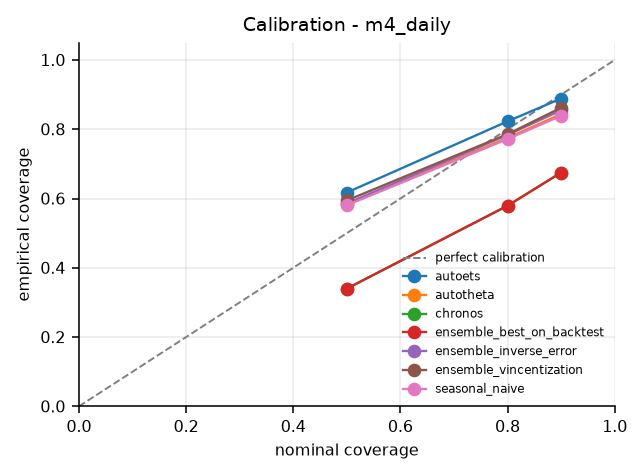
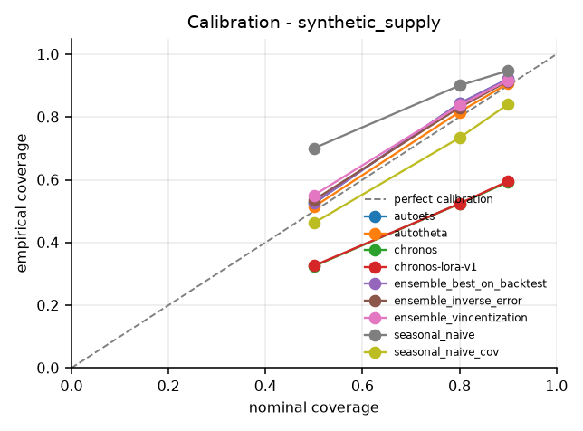
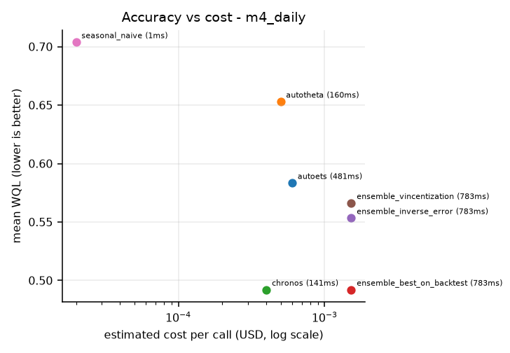
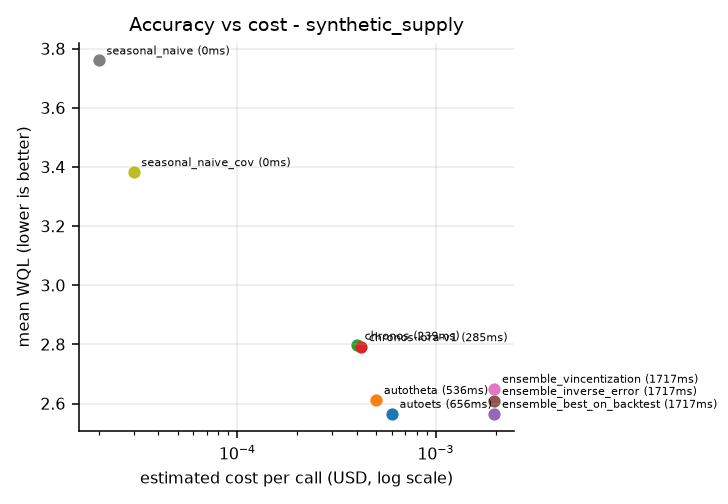
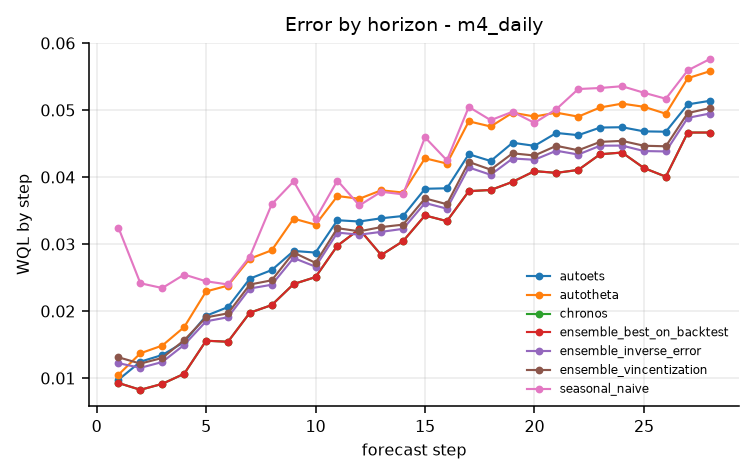
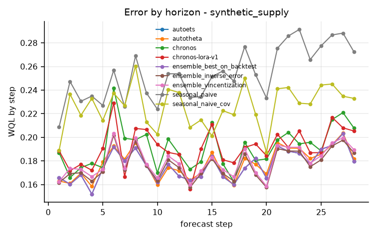

# ForecastMCP benchmark summary

Benchmark run id: `benchmark`
Bootstrap resamples: 1000 (seed 42). All metrics are means over eligible series; brackets are 95% percentile bootstrap CIs from series-level resampling.

## Datasets

| dataset | series | freq | horizon | windows |
|---|---:|---|---:|---:|
| synthetic_supply | 50 | D | 28 | 6 |
| m4_daily | 23 | D | 28 | 6 |

## synthetic_supply

| model | WQL | CRPS | MASE | cov@50 | cov@80 | cov@90 | median latency (ms) | est. cost/call (USD) |
|---|---|---|---|---|---|---|---:|---:|
| autoets | 2.5660 [1.9077, 3.2701] | 50.3344 [36.5300, 65.9401] | 0.8846 [0.8247, 0.9459] | 0.525 [0.472, 0.573] | 0.843 [0.818, 0.867] | 0.921 [0.906, 0.936] | 656.2 | 0.000600 |
| autotheta | 2.6127 [1.9607, 3.3195] | 50.8180 [37.1263, 66.4747] | 0.9121 [0.8536, 0.9775] | 0.514 [0.465, 0.560] | 0.816 [0.789, 0.842] | 0.907 [0.892, 0.922] | 535.8 | 0.000500 |
| chronos | 2.7966 [2.1028, 3.5478] | 54.6923 [39.9423, 72.4275] | 0.9460 [0.8888, 1.0008] | 0.324 [0.296, 0.355] | 0.524 [0.480, 0.568] | 0.593 [0.544, 0.641] | 239.1 | 0.000400 |
| chronos-lora-v1 | 2.7915 [2.0780, 3.5540] | 54.7824 [39.5905, 72.5066] | 0.9391 [0.8822, 0.9959] | 0.326 [0.295, 0.357] | 0.524 [0.480, 0.568] | 0.595 [0.547, 0.644] | 285.4 | 0.000420 |
| ensemble_best_on_backtest | 2.5660 [1.9077, 3.2701] | 50.3344 [36.5300, 65.9401] | 0.8846 [0.8247, 0.9459] | 0.525 [0.472, 0.573] | 0.843 [0.818, 0.867] | 0.921 [0.906, 0.936] | 1717.2 | 0.001970 |
| ensemble_inverse_error | 2.6097 [1.9498, 3.3268] | 50.5318 [36.8432, 66.6581] | 0.8963 [0.8405, 0.9536] | 0.535 [0.501, 0.569] | 0.830 [0.811, 0.850] | 0.914 [0.904, 0.925] | 1717.2 | 0.001970 |
| ensemble_vincentization | 2.6508 [1.9810, 3.3733] | 51.2781 [37.3884, 67.6505] | 0.9069 [0.8513, 0.9641] | 0.551 [0.517, 0.584] | 0.837 [0.818, 0.855] | 0.918 [0.907, 0.928] | 1717.2 | 0.001970 |
| seasonal_naive | 3.7609 [2.8908, 4.7105] | 72.4164 [53.5273, 93.8400] | 1.1554 [1.0864, 1.2340] | 0.701 [0.672, 0.728] | 0.900 [0.885, 0.915] | 0.948 [0.939, 0.956] | 0.4 | 0.000020 |
| seasonal_naive_cov | 3.3833 [2.5122, 4.3287] | 64.5833 [46.6067, 85.6248] | 1.0968 [1.0280, 1.1682] | 0.462 [0.443, 0.484] | 0.734 [0.703, 0.763] | 0.840 [0.817, 0.863] | 0.4 | 0.000030 |

Best single model by mean WQL: `autoets`.

## m4_daily

| model | WQL | CRPS | MASE | cov@50 | cov@80 | cov@90 | median latency (ms) | est. cost/call (USD) |
|---|---|---|---|---|---|---|---:|---:|
| autoets | 0.5834 [0.3694, 0.8575] | 146.7353 [97.3731, 210.7725] | 1.7018 [1.2997, 2.1412] | 0.617 [0.521, 0.714] | 0.823 [0.750, 0.889] | 0.889 [0.826, 0.943] | 481.0 | 0.000600 |
| autotheta | 0.6529 [0.4144, 0.9560] | 161.2559 [106.4531, 235.1444] | 1.7968 [1.3780, 2.2915] | 0.584 [0.481, 0.687] | 0.775 [0.685, 0.856] | 0.844 [0.767, 0.913] | 160.2 | 0.000500 |
| chronos | 0.4921 [0.3389, 0.6943] | 128.0327 [88.4170, 179.6454] | 1.8886 [1.4261, 2.3593] | 0.340 [0.296, 0.385] | 0.579 [0.519, 0.635] | 0.675 [0.615, 0.731] | 141.3 | 0.000400 |
| ensemble_best_on_backtest | 0.4921 [0.3389, 0.6943] | 128.0327 [88.4170, 179.6454] | 1.7211 [1.3247, 2.1613] | 0.340 [0.296, 0.385] | 0.579 [0.519, 0.635] | 0.675 [0.615, 0.731] | 782.9 | 0.001520 |
| ensemble_inverse_error | 0.5534 [0.3678, 0.7843] | 138.9923 [96.1448, 195.8477] | 1.7407 [1.3241, 2.2122] | 0.586 [0.489, 0.683] | 0.784 [0.712, 0.851] | 0.855 [0.792, 0.911] | 782.9 | 0.001520 |
| ensemble_vincentization | 0.5662 [0.3759, 0.7992] | 141.8810 [97.9042, 199.9137] | 1.7553 [1.3310, 2.2380] | 0.594 [0.495, 0.695] | 0.786 [0.710, 0.854] | 0.862 [0.798, 0.918] | 782.9 | 0.001520 |
| seasonal_naive | 0.7038 [0.4606, 0.9991] | 174.4503 [119.8649, 247.5335] | 2.1228 [1.5543, 2.7570] | 0.580 [0.468, 0.692] | 0.772 [0.667, 0.867] | 0.839 [0.750, 0.918] | 0.5 | 0.000020 |

Best single model by mean WQL: `chronos`.

## Zero-shot vs LoRA fine-tuned (independent compare run)

Evaluated 20 series over 6 frozen windows. Delta is fine-tuned minus zero-shot; negative is better for error metrics. Paired bootstrap significance for the benchmark run is in the deltas table below.

| metric | zero-shot | fine-tuned | delta |
|---|---|---|---|
| WQL | 2.3113 | 2.3099 | -0.0014 |
| CRPS | 47.4172 | 48.2956 | +0.8784 |
| MASE | 0.9180 | 0.9145 | -0.0035 |
| coverage_80 | 0.5176 | 0.5182 | +0.0006 |
| coverage_90 | 0.5899 | 0.5851 | -0.0048 |

## Paired bootstrap deltas

| dataset | comparison | metric | delta (A-B) | 95% CI | crosses zero |
|---|---|---|---:|---|---|
| synthetic_supply | zero_shot_vs_lora (chronos-lora-v1 - chronos) | WQL | -0.0052 | [-0.0506, +0.0533] | True |
| synthetic_supply | zero_shot_vs_lora (chronos-lora-v1 - chronos) | CRPS | +0.0901 | [-0.8851, +1.3825] | True |
| synthetic_supply | zero_shot_vs_lora (chronos-lora-v1 - chronos) | MASE | -0.0070 | [-0.0194, +0.0055] | True |
| synthetic_supply | zero_shot_vs_lora (chronos-lora-v1 - chronos) | coverage_80 | +0.0004 | [-0.0120, +0.0132] | True |
| synthetic_supply | ensemble_vs_best_single (ensemble_best_on_backtest - autoets) | WQL | +0.0000 | [+0.0000, +0.0000] | True |
| synthetic_supply | ensemble_vs_best_single (ensemble_best_on_backtest - autoets) | CRPS | +0.0000 | [+0.0000, +0.0000] | True |
| synthetic_supply | ensemble_vs_best_single (ensemble_best_on_backtest - autoets) | MASE | +0.0000 | [+0.0000, +0.0000] | True |
| synthetic_supply | ensemble_vs_best_single (ensemble_best_on_backtest - autoets) | coverage_80 | +0.0000 | [+0.0000, +0.0000] | True |
| synthetic_supply | ensemble_vs_best_single (ensemble_inverse_error - autoets) | WQL | +0.0436 | [+0.0058, +0.0830] | False |
| synthetic_supply | ensemble_vs_best_single (ensemble_inverse_error - autoets) | CRPS | +0.1974 | [-0.6662, +1.1052] | True |
| synthetic_supply | ensemble_vs_best_single (ensemble_inverse_error - autoets) | MASE | +0.0118 | [-0.0022, +0.0259] | True |
| synthetic_supply | ensemble_vs_best_single (ensemble_inverse_error - autoets) | coverage_80 | -0.0130 | [-0.0296, +0.0045] | True |
| synthetic_supply | ensemble_vs_best_single (ensemble_vincentization - autoets) | WQL | +0.0848 | [+0.0395, +0.1315] | False |
| synthetic_supply | ensemble_vs_best_single (ensemble_vincentization - autoets) | CRPS | +0.9436 | [+0.0914, +1.9497] | False |
| synthetic_supply | ensemble_vs_best_single (ensemble_vincentization - autoets) | MASE | +0.0223 | [+0.0082, +0.0371] | False |
| synthetic_supply | ensemble_vs_best_single (ensemble_vincentization - autoets) | coverage_80 | -0.0065 | [-0.0243, +0.0120] | True |
| synthetic_supply | with_vs_without_covariates (seasonal_naive_cov - seasonal_naive) | WQL | -0.3776 | [-0.4598, -0.3003] | False |
| synthetic_supply | with_vs_without_covariates (seasonal_naive_cov - seasonal_naive) | CRPS | -7.8331 | [-10.0220, -5.7516] | False |
| synthetic_supply | with_vs_without_covariates (seasonal_naive_cov - seasonal_naive) | MASE | -0.0586 | [-0.0736, -0.0455] | False |
| synthetic_supply | with_vs_without_covariates (seasonal_naive_cov - seasonal_naive) | coverage_80 | -0.1668 | [-0.1880, -0.1478] | False |
| m4_daily | ensemble_vs_best_single (ensemble_best_on_backtest - chronos) | WQL | +0.0000 | [+0.0000, +0.0000] | True |
| m4_daily | ensemble_vs_best_single (ensemble_best_on_backtest - chronos) | CRPS | +0.0000 | [+0.0000, +0.0000] | True |
| m4_daily | ensemble_vs_best_single (ensemble_best_on_backtest - chronos) | MASE | -0.1675 | [-0.4890, +0.0066] | True |
| m4_daily | ensemble_vs_best_single (ensemble_best_on_backtest - chronos) | coverage_80 | +0.0000 | [+0.0000, +0.0000] | True |
| m4_daily | ensemble_vs_best_single (ensemble_inverse_error - chronos) | WQL | +0.0613 | [-0.0047, +0.1423] | True |
| m4_daily | ensemble_vs_best_single (ensemble_inverse_error - chronos) | CRPS | +10.9595 | [-1.7113, +24.6991] | True |
| m4_daily | ensemble_vs_best_single (ensemble_inverse_error - chronos) | MASE | -0.1479 | [-0.5183, +0.0791] | True |
| m4_daily | ensemble_vs_best_single (ensemble_inverse_error - chronos) | coverage_80 | +0.2045 | [+0.1328, +0.2837] | False |
| m4_daily | ensemble_vs_best_single (ensemble_vincentization - chronos) | WQL | +0.0741 | [+0.0006, +0.1654] | False |
| m4_daily | ensemble_vs_best_single (ensemble_vincentization - chronos) | CRPS | +13.8483 | [-0.3104, +29.1839] | True |
| m4_daily | ensemble_vs_best_single (ensemble_vincentization - chronos) | MASE | -0.1332 | [-0.5066, +0.1022] | True |
| m4_daily | ensemble_vs_best_single (ensemble_vincentization - chronos) | coverage_80 | +0.2065 | [+0.1312, +0.2886] | False |

## Ablations

- **zero_shot_vs_finetuned**: reported in paired_deltas under zero_shot_vs_lora
- **covariates**: seasonal_naive_cov vs seasonal_naive in paired_deltas; Chronos T5 does not consume covariates so no foundation-model covariate arm exists
- **univariate_vs_multivariate**: TimesFM and Moirai (the covariate/multivariate-capable adapters) are not installed; see unavailable_models
- **ensemble_vs_best_single**: reported in paired_deltas under ensemble_vs_best_single

## Agent harness metrics

12 tasks x 3 trials = 36 runs; benchmark oracle run `benchmark`.

| metric | value |
|---|---:|
| success rate | 1.0000 |
| tool-call validity rate | 1.0000 |
| selection regret (WQL vs oracle) | 0.0911 |
| ensemble regret (WQL vs oracle) | 0.1576 |
| unsupported-number rate | 0.0000 |
| budget adherence rate | 1.0000 |
| recovery rate after injected failure | 1.0000 |
| mean latency per task (s) | 6.2216 (run-to-run std 1.7948) |
| mean cost per task (USD) | 0.003060 (run-to-run std 0.000000) |
| selection regret run-to-run std | 0.0000 |

| task | success | selection regret | latency (s) | cost (USD) |
|---|---:|---:|---:|---:|
| t01 | 1.00 | +0.0000 | 5.39 | 0.003060 |
| t02 | 1.00 | +0.0000 | 4.01 | 0.003060 |
| t03 | 1.00 | +0.0972 | 4.20 | 0.003060 |
| t04 | 1.00 | +0.4073 | 4.25 | 0.003060 |
| t05 | 1.00 | +0.0021 | 7.58 | 0.003060 |
| t06 | 1.00 | +0.3443 | 7.31 | 0.003060 |
| t07 | 1.00 | +0.0032 | 7.32 | 0.003060 |
| t08 | 1.00 | +0.1571 | 3.77 | 0.003060 |
| t09 | 1.00 | +0.0100 | 7.29 | 0.003060 |
| t10 | 1.00 | +0.0000 | 8.04 | 0.003060 |
| t11 | 1.00 | +0.0464 | 8.39 | 0.003060 |
| t12 | 1.00 | +0.0254 | 7.10 | 0.003060 |

## Model availability

| model | available | ran on | reason |
|---|---|---|---|
| seasonal_naive | True | synthetic_supply, m4_daily | statsforecast importable |
| autoets | True | synthetic_supply, m4_daily | statsforecast importable |
| autotheta | True | synthetic_supply, m4_daily | statsforecast importable |
| seasonal_naive_cov | True | synthetic_supply | ok |
| chronos | True | synthetic_supply, m4_daily | chronos importable (cached) |
| chronos-small | False | - | disabled in configs/models.yaml |
| chronos-lora-v1 | True | synthetic_supply | base + adapter available |
| timesfm | False | - | timesfm not importable (ModuleNotFoundError: No module named 'timesfm'); install the [fm] extra |
| moirai | False | - | uni2ts not importable (ModuleNotFoundError: No module named 'uni2ts'); install the [fm] extra |

## Figures

